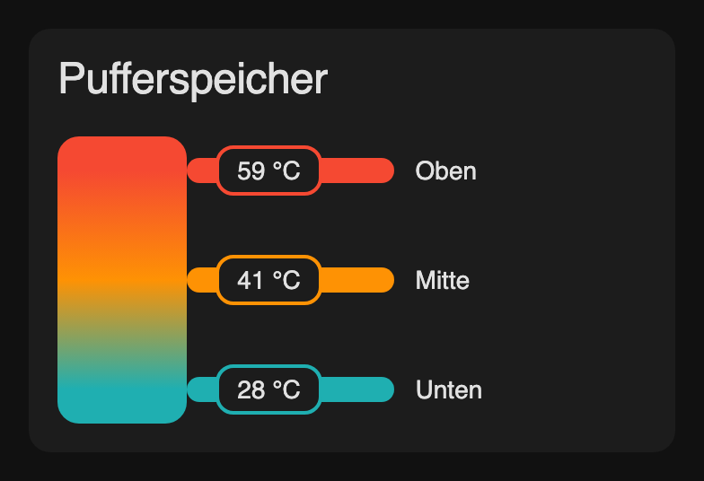

# Buffer Tank Card

[](https://hacs.xyz/docs/faq/custom_repositories)
[](https://github.com/fuslwusl/homeassistant-buffer-tank-card/actions/workflows/validate.yaml)
[](LICENSE)

A Home Assistant dashboard card that visualizes the temperature stratification of a buffer tank (Pufferspeicher) or hot water tank. One to four temperature sensors are shown along the tank, and the tank is filled with a continuous color gradient interpolated from their values.



- Standalone: no build step, no external libraries, no CDN
- 1 to 4 sensors (`top`, `middle`, `extra`, `bottom`)
- Color scale from blue (cold) via green/turquoise and orange to red (hot)
- Uses the Home Assistant theme: standard card header, theme fonts and colors, light and dark mode
- Click or press Enter on a value to open the entity's more-info dialog
- Available in the card picker with a live preview

## Installation

### HACS (recommended)

1. Open HACS in Home Assistant.
2. Open the menu (⋮) → **Custom repositories**.
3. Add `https://github.com/fuslwusl/homeassistant-buffer-tank-card` with type **Dashboard**.
4. Search for **Buffer Tank Card** and download it.
5. Reload the browser (hard refresh, or clear the frontend cache in the Companion app).

HACS adds the dashboard resource automatically.

### Manual

1. Download `buffer-tank-card.js` from the [latest release](https://github.com/fuslwusl/homeassistant-buffer-tank-card/releases/latest).
2. Copy it to `/config/www/community/buffer-tank-card/buffer-tank-card.js`.
3. Add a dashboard resource (Settings → Dashboards → ⋮ → Resources):
   - URL: `/local/community/buffer-tank-card/buffer-tank-card.js`
   - Type: **JavaScript module**
4. Reload the browser.

## Configuration

Add the card via the card picker (**Buffer Tank Card**) or as a manual card:

```yaml
type: custom:buffer-tank-card
name: Pufferspeicher
min_temp: 20
max_temp: 60
top:
  entity: sensor.heating_hotwater_temperature
  label: Oben
middle:
  entity: sensor.heating_dhwtank_mid_temperature
  label: Mitte
bottom:
  entity: sensor.heating_solar_dhwtank_temperature
  label: Unten
```

### Options

| Option | Type | Default | Description |
| --- | --- | --- | --- |
| `type` | string | **required** | `custom:buffer-tank-card` |
| `name` | string | `Pufferspeicher` | Card title. Set to `""` to hide the header. |
| `top` | object | – | Sensor shown at the top of the tank (see below). |
| `middle` | object | – | Sensor shown in the middle. |
| `extra` | object | – | Additional sensor between middle and bottom. |
| `bottom` | object | – | Sensor shown at the bottom. |
| `min_temp` | number | `20` | Temperature shown in blue (start of the color scale). |
| `max_temp` | number | `60` | Temperature from which everything is shown in red. |
| `height` | number | `160` | Tank height in px. Minimum `120`. |
| `show_labels` | boolean | `true` | Show the labels next to the values. |
| `unit` | string | `°C` | Fallback unit if a sensor has no `unit_of_measurement`. |

Each sensor position (`top`, `middle`, `extra`, `bottom`) accepts:

| Option | Type | Default | Description |
| --- | --- | --- | --- |
| `entity` | string | **required** | Temperature sensor entity ID. |
| `label` | string | `Oben` / `Mitte` / `Zusatz` / `Unten` | Label shown next to the value. |
| `unit` | string | sensor unit | Overrides the displayed unit. |

At least one position must be configured. One to four sensors are distributed evenly along the tank height. Values are rounded to whole degrees; `unknown` and `unavailable` are shown as `—` in grey.

### Color scale

Colors are placed relative to `min_temp` … `max_temp`:

| Position in range | Default temperature | Color |
| --- | --- | --- |
| 0 % | 20 °C | Blue |
| 25 % | 30 °C | Green/turquoise |
| 50 % | 40 °C | Orange |
| 100 % | 60 °C | Red |

Values below `min_temp` stay blue, values above `max_temp` stay red. Between the points the colors are blended continuously.

## Credits

The visual design is inspired by [giorgioparri/puffer-card](https://github.com/giorgioparri/puffer-card). This card is an independent implementation; it does not include that card's visual editor, history chart or `info` extras.

## License

[MIT](LICENSE)
